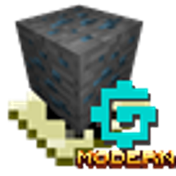

# VisualVein: GTCEu (Xaero edition)

[简体中文](README.zh-CN.md)<br>
A Minecraft **1.20.1 / Forge** addon for **GregTech CEu Modern (GTCEu)** that records GTCEu ore veins and
renders manually discovered veins on **Xaero's World Map** and **Xaero's Minimap**.

This branch is the **JourneyMap-free Xaero edition**. It does not load or require JourneyMap.

> **v1.0.0-xaero** — first Xaero-native release. Ore and fluid overlays, texture/color markers,
> pinyin search, depletion state, safe teleport, safe waypoints and Xaero-native right-click menu
> integration.

- **Mod ID**: `visualvein`
- **Version**: `1.0.0-xaero`
- **License**: LGPL-3.0-only
- **Requirements**: Forge 47.x, GTCEu Modern 1.20.1 (1.4.4+), Xaero's World Map 1.47.0+,
  Xaero's Minimap 26.6.0+ (client only)
- **Install side**: the mod is required on **both client and server**; the Xaero mods are client-only.
- **Target branch**: `Xareo-version`

## Features

### Manual discovery, manual markers

- The server scans GTCEu's vein grid and stores veins it has seen.
- A vein is shown on the map only after the player manually marks it with a surface rock, an ore block,
  or the GTCEu prospector.
- Bedrock fluid veins are discovered by the prospector in FLUID mode or by using an empty hand on bedrock.
- Markers can be marked depleted / restored from the native Xaero right-click menu.

### Xaero World Map

- One composed marker icon per vein: host-rock base, tinted GTCEu ore, bright frame and depletion cross.
- Texture mode and color mode.
- Ore / Fluid / Hide mode buttons in Xaero's right sidebar.
- Fluid veins are drawn as full 16×16 chunk tints, with yellow chunk separators.
- Hovering a fluid chunk shows chunk yield, region yield and remaining operations.
- Fully exhausted fluid veins (operations ≤ 0) are removed from the overlay.

### Xaero Minimap

- Marked ore veins are shown as small markers.
- Each fluid region is represented by one region marker, not 64 chunk elements, to keep frame time low.
- Overlay data is rebuilt only when the client cache or dimension changes.

### Search

- Native-style search icon in the Xaero sidebar.
- Clicking the icon opens an inline field to its left; clicking again closes it.
- Matches vein names, ore/material names, Chinese names, full pinyin (`tongkuang`) and initials (`tk`).
- Non-matching markers are dimmed; matches stay highlighted. The minimap uses the same search state.

### Waypoints and teleport

- Native right-click options: Create Waypoint, Safe Teleport.
- Waypoints use a safe surface column near the vein and are shared by Xaero's World Map and Minimap.
- Safe teleport is handled server-side: it searches two-block air with a solid, non-fluid floor around
  the vein center and refuses unsafe destinations.

## Build

```bash
./gradlew build
```

The output jar is `build/libs/visualvein-xaero-1.0.0-xaero.jar`.

Compile-time dependencies:

- GTCEu 1.20.1 1.4.4 (local `libs/gtceu-1.20.1-1.4.4.jar`, not redistributed)
- Xaero World Map 1.47.0 / Minimap 26.6.0 / XaeroLib 1.7.3 from Xaero's Maven

## License and notices

VisualVein is licensed under **LGPL-3.0-only**. See `LICENSE` and `THIRD_PARTY_NOTICES.md`.

Xaero's mods are All Rights Reserved and are not bundled with this mod. GTCEu and Minecraft textures
are loaded from the installed game at runtime and are not redistributed in the jar.
